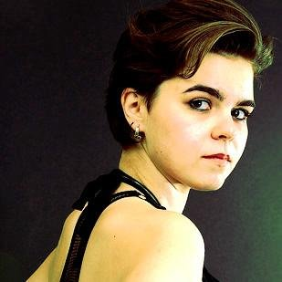

Hi, my name is Marie, or shiro, depending on where I am and who you ask.  
  
I was born and grew up in France, where I studied French and German literature in a “Classe préparatoire aux grandes écoles”. In 2010 I moved to Germany, where I studied Cultural Journalism at the university of the Arts.

When I was writing my master thesis about the sustainability of pure online media, Edward Snowden’s revelations about the NSA’s mass surveillance happened. Quickly, I realized that with my journalism degree, I was not at all equipped to deal with sensitive cases where journalists need to operate at a high level of security and use the right tools and strategies to protect their sources. I realized that actually, few journalists were equipped for this (and still are to this day).

Since, I have been focusing on working to help journalists and activist who need to protect themselves and their sources – and have extended my actions to privacy and digital rights in general.

In 2014 I started helping to build up CryptoParty in Berlin and took my first trip to eastern Europe to spread the word.

In 2015, while still working on CryptoParty, I started training students at various journalism schools. I started volunteering for the Tor Project, organizing support actions for WikiLeaks whistleblower Chelsea Manning, and campaigned in support for journalists of German media outlets Netzpolitik.org who were accused of high treason for publishing leaked documents. I also worked as a freelance journalist for French and Germany media on the topics of surveillance and privacy.

In 2016 I was part of the core team for the Logan CIJ Symposium, an event about journalism, information security and privacy, which welcomed 700 international guests for a weekend in Berlin.

In 2017 I worked for the German foundation Wau Holland Stiftung and I campaigned for the Courage foundation. I organized the first Berlin Transcyberian Event, putting the party back in CryptoParty.

From early 2018 to June 2019 I worked for Nextcloud. In June 2019 I joined the Prototype Fund team as a program manager and events organizer at Open Knowledge Foundation Germany. I am also a board member of c-base hackerspace, and still organizing privacy events and training journalists and activists.

You can find my CV [here](/wp-content/uploads/2019/06/marie_gutbub_cv_web_limitedcontactdata.pdf).
