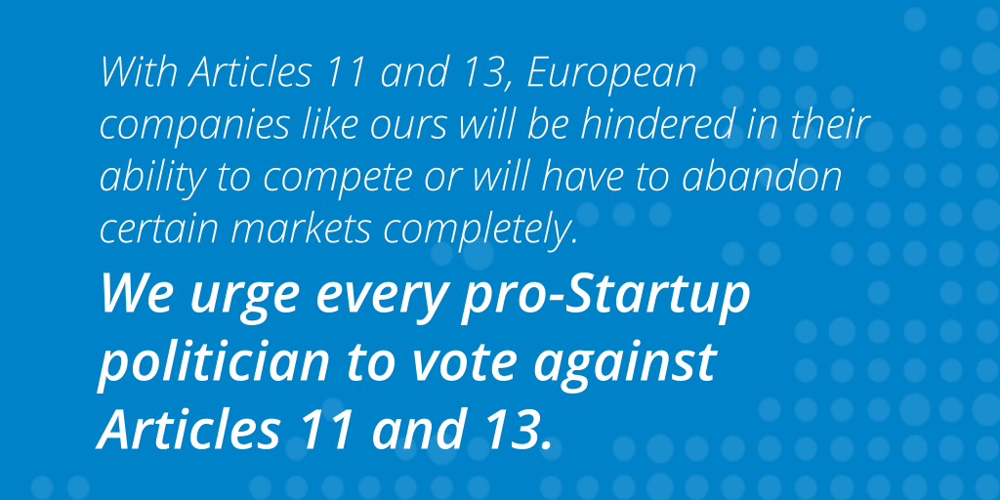

In March 2019 I coordinated the open letter from businesses against Articles 11 & 13 of the EU copyright directive written by Nextcloud founder & CEO Frank Karlitschek.  
Read [here](https://nextcloud.com/blog/130-eu-businesses-sign-open-letter-against-copyright-directive-art-11-13/).
