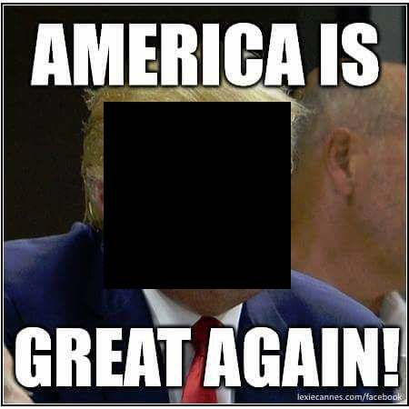
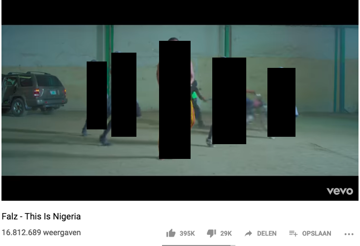
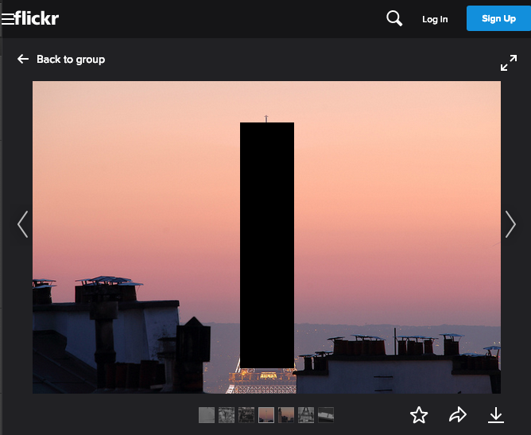
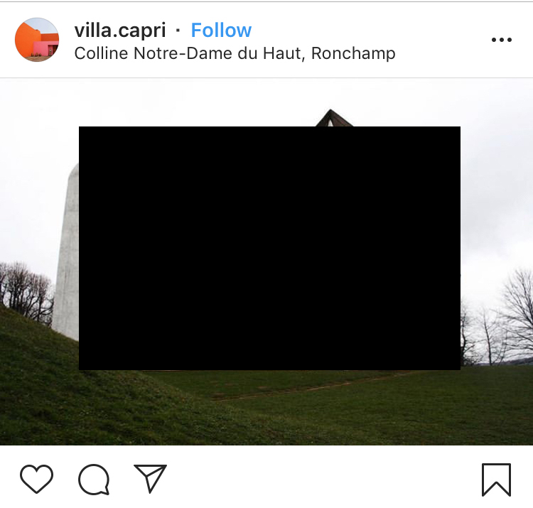

_Article de Joe McNamee initialement publié le 14 Mars 2019 sur_ [_thehmm.nl_](https://thehmm.nl/is-article-13-really-the-end-of-the-open-internet/) _(en anglais) – traduction par Marie Gutbub – CC BY-SA 4.0_

La nouvelle directive européenne sur le droit d’auteur a suscité de nombreuses controverses. Une grande partie de cette controverse porte sur le fameux “article 13”. À en croire les opposants à la directive, c’est la fin de l’Internet tel que nous le connaissons. L’Internet où tout le monde peut communiquer avec tout le monde, sans permission préalable, disparaîtrait. Si vous écoutez les partisans de la directive, elle permettra enfin aux créateurs et aux artistes de mieux contrôler leurs droits en ligne, après des années d’abus de droits d’auteur facilités par les géants du Web. Face à tout ce vacarme, il est difficile de comprendre ce qui se trame.

La raison pour laquelle le sujet fait l’objet de telles discussions est que la proposition est très complexe, notamment parce que l’article 13 ne constitue pas une seule et même proposition. Il s’agit d’un texte de 1 200 mots sur le filtrage, la responsabilité des plateformes sur Internet, les licences, les mécanismes de recours et la coopération entre les titulaires de droits d’auteur et les plateformes Internet. La situation est exacerbée par le fait qu’il tente de rééquilibrer trois relations distinctes : celle entre plateformes et utilisateurs, celle entre plateformes et titulaires de droits d’auteur, et celle entre utilisateurs et titulaires de droits d’auteur, même si, évidemment, nous sommes nombreux à être à la fois titulaires de droits d’auteurs et utilisateurs. Une discussion équilibrée est également rendue plus difficile par la contradiction entre les attentes des créateurs et l’imprécision de la proposition et par les conséquences involontaires que ses opposants prévoient.

Ceux qui soutiennent la proposition espèrent que les plus grandes plateformes devront payer pour la publication de contenus protégé par le droit d’auteur ou bloquer le contenu qui n’est pas autorisé à être publié sur le site. Cet espoir est-il justifié ?

## La proposition

#### Quel contenu est protégé ?

La proposition fait référence aux “œuvres ou autres objets protégés”. Il s’agit là de tout ce qui est soumis à la protection des droits de propriété intellectuelle – le droit d’auteur, mais aussi d’autres droits protégés par la notion au sens large de “propriété intellectuelle”. Cette notion couvre les choses évidentes comme la vidéo et l’audio, mais aussi des éléments moins évidents comme la chorégraphie et les marques de commerce.

#### Quelles entreprises du Web seront concernées ?

Toutes les entreprises du Web qui hébergent, diffusent et “organisent” \[“organise”\] de “grandes quantités d’œuvres ou d’autres objets” pour leurs utilisateurs, sont concernées, tant qu’elles ont un but lucratif, et à l’exception des plus petites si elles existent depuis moins de trois ans. Malheureusement, personne ne sait ce que tout cela signifie vraiment. La référence à l'”organisation” fait écho à une affaire de la Cour européenne concernant The Pirate Bay, de sorte qu’il appartiendra aux tribunaux des 27 États membres de l’UE de définir ce que cela signifie par rapport aux services plus traditionnels. Personne ne sait non plus ce que signifie “grandes quantités”. Une chose est cependant claire : malgré toutes les interprétations politiques qui prétendent le contraire, il ne s’agit pas uniquement de musique et de vidéo, ni de Google et de Facebook seulement.

#### Que sont-elles censées faire ?

Les plateformes sont censées faire tout ce qui est en leur pouvoir \[“best efforts”\] pour empêcher les téléversements futurs de tout matériel ayant fait l’objet d’un “avis suffisamment motivé” \[“sufficiently substantiated notice”\] par des personnes ou des sociétés prétendant avoir des droits sur ce matériel. Il peut s’agir d’audio, de vidéo, de texte, d’images représentant du texte, d’images, de photographies, de chorégraphies, etc. Les plateformes devront également rendre compte aux titulaires de droits de l’efficacité des technologies qu’elles utilisent pour atteindre cet objectif. La bonne nouvelle pour ceux qui font de fausses déclarations de droits d’auteur est que cela n’est pas sanctionné par la directive. Cela signifie que n’importe qui peut faire une réclamation sur n’importe quel contenu sans être pénalisé. Même dans le cadre juridique existant, il est si facile et sans risque de faire de fausses déclarations que des escrocs ont récemment commencé à exiger de l’argent des canaux YouTube, offrant en échange de ne pas soumettre de fausses déclarations de droit d’auteur. L’article 13 étend le pouvoir de ceux qui portent plainte, mais ne fait rien pour les rendre plus responsables.

#### Quels types d’utilisation seront interdits ?

Dans notre société, la liberté est la valeur par défaut et les restrictions, y compris le droit d’auteur, sont l’exception. Afin de s’assurer que les restrictions en matière de droit d’auteur ne sont pas excessives, des exceptions sont prévues. Par exemple, il existe des exceptions facultatives dans l’UE pour autoriser l’utilisation de contenu protégé par le droit d’auteur à des fins privées, parodiques, éducatives, etc. En vertu de l’article 13, les filtres devraient pouvoir reconnaître ces exceptions. Ils en sont incapables. Par conséquent, ces exceptions cruciales seront impossibles à appliquer.

En outre, des lois absurdes, qui n’ont presque jamais été appliquées, deviendront soudain faciles à mettre en œuvre. Dans certains pays de l’UE, le fait de prendre des photos ou des vidéos de bâtiments ou de sculptures qui se trouvent dans des lieux publics, voire de les peindre, constitue une violation du droit d’auteur. Ainsi, par exemple, si vous êtes photographe et que votre photo comprend un bâtiment conçu par un architecte qui souhaite revendiquer son droit, votre photo pourrait ainsi être bloquée pour le téléchargement. (De même, les mèmes utilisent fréquemment du contenu protégé par le droit d’auteur, de sorte qu’ils pourraient également être éliminés par filtrage, si le détenteur des droits le demande.)

En vertu de l’article 13, les filtres devraient non seulement être en mesure de reconnaître et de bloquer tous les bâtiments “identifiés”, mais ils devraient aussi tenir compte des régimes nationaux sur le droit d’auteur. Selon les règles françaises, italiennes et slovènes, qui ont une liberté de panorama limitée ou nulle, les filtres devraient bloquer de telles images. En vertu des règles autrichiennes, britanniques et irlandaises, l’image pourrait être autorisée sur le Web. Libre à tout un chacun de deviner comment une plateforme qui opère dans tous ces pays est censée appliquer ses filtres.

Indépendamment de l’intention du législateur, les plateformes adopteront évidemment la voie la plus simple : ne pas prendre en compte toutes ces exceptions et contextes nationaux, et bloquer tout ce qui pourrait constituer une violation. Le blocage ne crée aucun risque juridique, tandis que le fait de permettre la publication d’un contenu crée un risque.

#### Les utilisateurs auront-ils un moyen de faire valoir leurs droits ?

Même pour les rédacteurs initiaux de l’article 13, tout cela semblait quelque peu unilatéral, de sorte qu’il a été décidé qu’un certain équilibre devait être rétabli. Il est donc proposé dans l’article 13 que, lorsque les informations des utilisateurs sont supprimées, ils devront disposer d’un mécanisme de recours. Ou, plus précisément, si la plateforme admet à l’utilisateur que ses données ont été supprimées sur la base d’une mise en œuvre nationale de l’article 13.1 de la directive sur le droit d’auteur, l’utilisateur aura alors droit à un recours. Toutefois, si la plateforme choisit de déclarer que la suppression résulte d’une violation des conditions de service, elle n’a pas à assumer les frais de mise en place ou d’application du mécanisme de recours. Il y a donc un mécanisme de recours dans la directive, mais il n’existera pas dans le monde réel. La promesse que les utilisateurs auront un moyen significatif de s’opposer et de faire valoir leurs droits n’est tout simplement pas vraie.

## Conséquences

#### Qui bénéficiera de la proposition ?

Dans ces conditions, quelles sont les plateformes susceptibles d’être en mesure de faire face aux exigences imprévisibles et aux coûts inconnus que représente le respect de ces règles ? Petites startups, ou Google et Facebook ? Quels titulaires de droits seront en mesure de fournir les bonnes informations à chaque service d’hébergement pertinent dans chaque pays concerné ? Artistes et créateurs indépendants, ou les plus grands ayants droit ? Devinez : les plus grands détenteurs de droits et les plus grandes plateformes sont les seuls dont on peut raisonnablement s’attendre à ce qu’ils soient en mesure de gérer ces changements à leur avantage.

#### Qu’en est il pour les créateurs ou artistes indépendants ?

En termes simples, les créateurs indépendants seront coincés derrière trois entités : les plateformes, les sociétés de gestion collective et les entreprises en charge du filtrage.

Tout d’abord, la liberté et le pouvoir de négociation des créateurs vont diminuer. Les grandes plateformes sont les seules à pouvoir survivre dans ce chaos juridique. Ainsi, les créateurs passent de la possibilité de partager leur contenu où bon leur semble, à l’utilisation de plus en plus limitée de quelques fournisseurs quasi-monopole. Ces plateformes ont le droit de bloquer le travail de qui que ce soit, si elles le souhaitent. Elles sont libres de ne pas conclure de contrat de licence et de bloquer les contenus, si elles le souhaitent. Elles sont libres de supprimer des contenus sur la base de fausses déclarations, si elles le souhaitent. Elles détiennent toutes les cartes de négociation. Afin d’entrer en contact avec des publics existants ou nouveaux, les créateurs et les artistes deviendront encore plus dépendants de ces quelques plateformes – et soumis à leurs caprices.

Par conséquent, la seule façon pour les créateurs de s’engager de manière significative dans ce système est d’unir leurs forces et de travailler avec une société de gestion collective, une deuxième entité entre elles et leur public. Ces entreprises accorderont des licences, identifieront les contenus et et produiront des rapports au nom du créateur, et prendront une part des revenus. Cela sera particulièrement préjudiciable aux nouveaux artistes, qui négocieront des contrats avec les sociétés de gestion collective à un moment où leur pouvoir de négociation est à son plus bas. S’ils choisissent de ne pas travailler avec une société de gestion collective, les artistes sont seuls, négociant avec Google pour obtenir des revenus, en demandant à Google d’actualiser sa base de données pour empêcher que leur contenu soit publié par des tiers, en luttant contre de fausses revendications sur la propriété de leurs œuvres ou en tentant de faire annuler des retraits non justifiés.

Et pour couronner le tout, très peu d’entreprises sont en mesure de fournir la technologie nécessaire pour remplir les obligations de la directive en ce qui concerne le filtrage des téléchargements. Quiconque met en premier une image, un son ou un clip vidéo dans les bases de données de ces sociétés, aura le contrôle des utilisations, remixes ou parodies ultérieures. Par conséquent, les compagnies de filtrage seront une troisième nouvelle entité entre l’artiste et le public. Cela signifie qu’il y aura toujours un risque que quelqu’un fasse quelque chose de semblable à votre oeuvre, ce qui empêche votre contenu d’être disponible. Cela se produit déjà. Dans un exemple particulièrement absurde, trente secondes d’une vidéo de neuf minutes d’un microphone testé ont été “identifiées” par YouTube ContentID comme étant le travail créatif d’une autre personne – et bloquées.

En vertu de l’article 13, nous passons d’un Internet où les artistes peuvent se connecter à leur public selon leurs propres termes, à un monde où un artiste doit concéder sous licence ses droits à une société de gestion collective, qui concédera sous licence (ou non) ses droits à un nombre restreint de plateformes en ligne américaines, qui auront le droit et la possibilité de fixer les termes de l’accord. Parce que si un accord n’est pas conclu en faveur de la plateforme, la plateforme choisira simplement d’interdire la disponibilité du contenu.

#### Ce n’est pas une question de violation des droits d’auteur, mais de contrôle de l’expression.

Ce n’est pas une question d’infractions. En effet, les propositions relatives à l’article 13 ne font pratiquement aucune mention des infractions. Il s’agit d'”identification”. Il s’agit ici de donner du pouvoir et du contrôle à des intermédiaires comme les sociétés de gestion collective. Il s’agit ici de donner des obligations aux entreprises en ligne que seules les plus grandes auront les moyens de gérer. Le préjudice et le fardeau seront répercutés sur les individus. Nous devinerons ce qui sera permis ou non et nous nous autocensurerons, sachant que nous sommes impuissants face à la mainmise des géants de l’Internet sur les plateformes de publication.

En résumé, des plateformes mal définies, craignant des règles de responsabilité floues, sont censées utiliser des technologies qui ne sont pas définies afin d’en faire “assez” \[“enough”\] (ce qui n’est pas clair) pour empêcher la disponibilité du contenu qui a été identifié par des ayants droit. Ceux qui procèdent à l'”identification” ne courent aucun risque juridique parce qu’il n’y a pas de pénalité pour les réclamations incorrectes. Les plateformes ne courent aucun risque juridique si elles suppriment tout ce qui pourrait causer un problème. Tous les préjudices et tous les risques sont à la charge de clui qui publie les données. Beaucoup d’inconnues, n’est-ce pas ? Et ce ne sont là que celles dont nous avons connaissance.

## Conclusion

Si l’article 13 obligeait les plus grandes plateformes à rendre des comptes, ce serait une bonne chose. Si l’article 13 permettait aux artistes d’atteindre plus facilement leur public, ce serait une bonne chose. Si l’article 13 réduisait le nombre d’entités entre les auteurs et leur public, donnant plus de pouvoir aux petits artistes, leur permettant d’être payés plus facilement pour leur travail, ce serait une bonne chose. Au lieu de cela, il détruit l’Internet tel que nous le connaissons, renforce les puissants et crée un chaos juridique. De nombreux opposants à l’article 13, y compris dans la société civile, soutiennent les objectifs de la proposition visant à donner plus de pouvoir et de contrôle aux artistes. Malheureusement, rien n’indique que la proposition ait la moindre chance d’atteindre cet objectif.

Comme l’a dit la Fédération internationale des journalistes : “La directive sur le droit d’auteur bafoue les droits d’auteur des journalistes en encourageant les contrats de rachat et en forçant les journalistes à renoncer à leurs droits et en donnant aux éditeurs la possibilité de faire des bénéfices supplémentaires alors que les journalistes ne reçoivent rien” ¹. Cette analyse s’applique à tous. L’article 13 n’est pas fait pour les artistes.

* * *

¹ “the Copyright Directive makes a mockery of journalists’ authors’ rights by promoting buy-out contracts and bullying to force journalists to sign away their rights and giving publishers a free ride to make more profits while journalists receive zero”

_A propos de l’auteur :  
Joe McNamee, ancien directeur exécutif de European Digital Rights (EDRi), a créé un espace à Bruxelles et au cœur de l’Union européenne pour faire entendre les droits fondamentaux numériques. EDRi s’est battu contre une réglementation excessive du droit d’auteur dans l’UE – tout récemment contre les articles 13 et 11. EDRi a également travaillé sur les règles européennes de neutralité du Net, contre la privatisation de l’application de la loi, et a joué un rôle déterminant dans la bataille de lobbying pour le RGPD, le ” Règlement général sur la protection des données ” qui a fait progresser la confidentialité numérique en Europe et au niveau mondial. McNamee a rejoint EDRi en 2009, à une époque où il n’y avait pas de groupes de défense des droits numériques basés à Bruxelles, malgré l’importance du processus décisionnel européen pour la liberté numérique mondiale. Au cours des neuf années qui se sont écoulées depuis, l’EDRi s’est développé pour devenir une partie intégrante de l’élaboration des politiques en matière de droits numériques. Avant de rejoindre EDRi, McNamee a travaillé pendant onze ans sur les questions liée à la politique du Net, notamment pour la European Internet Services Providers Association. Il a commencé sa carrière sur Internet en travaillant pour le service d’assistance de CompuServe UK en 1995._
