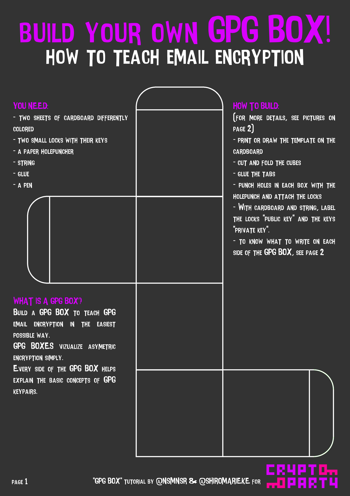
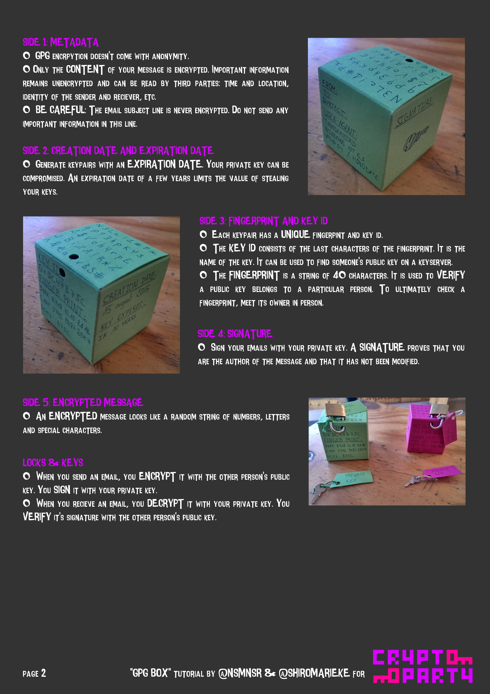

How to build a GPG Box to teach email encryption – a tutorial in collaboration with [@nsmnsr](https://twitter.com/nsmnsr). Featured on [boingboing](https://boingboing.net/2015/09/23/howto-make-a-physical-papercr.html).  
Download pdf on [Github](https://github.com/shiromarieke/shiro_tutorials/blob/master/gpgboxENG.pdf).  

