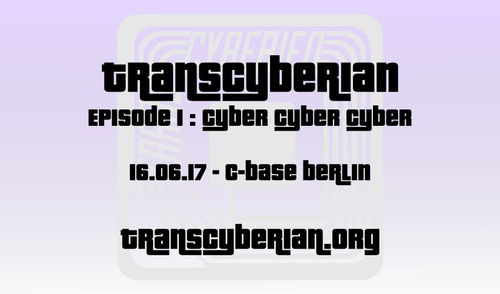
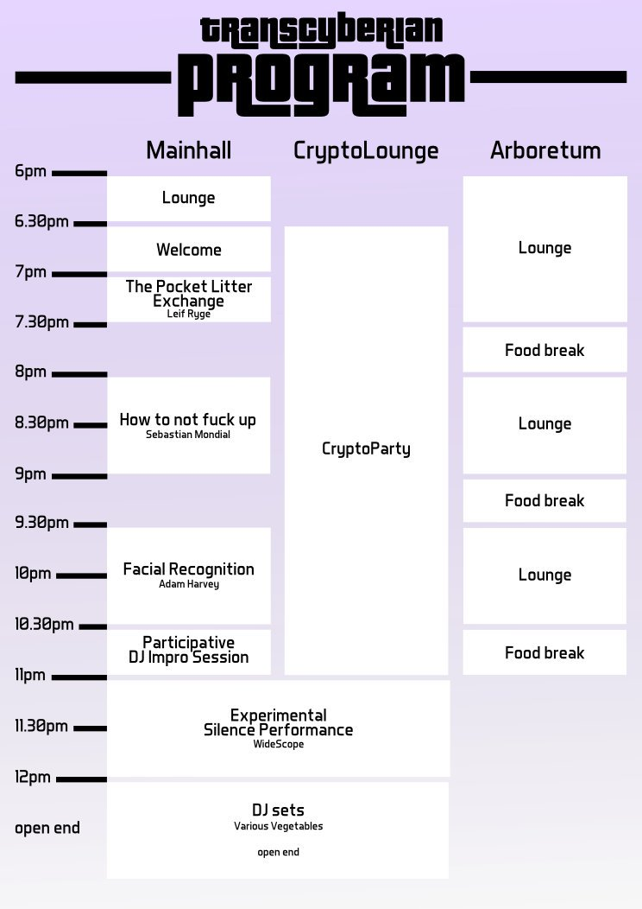
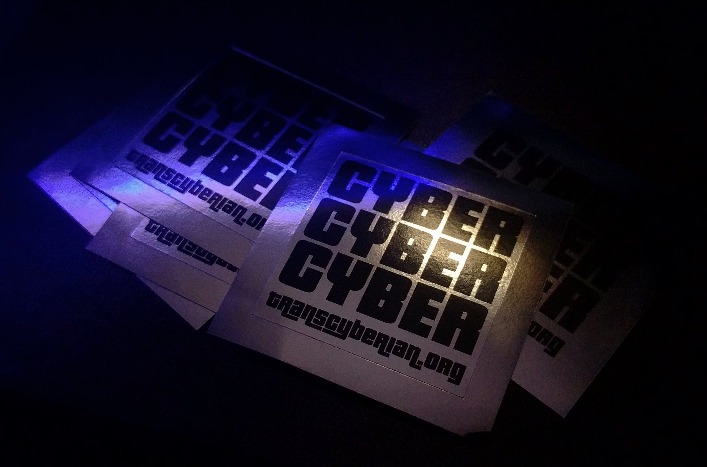

I organized the first edition of the Paris-born [Transcyberian](https://transcyberien.org/) in Berlin on June 16th, 2017, at c-base.

Transcyberian is a decentralized series of events combining talks and workshops about privacy and related topics with a real party with DJs.

You can find the program over you in the picture below or on the [website archive](https://archive.fo/UkRjT).

Follow us on twitter [@transcyb\_De](https://twitter.com/transcyb_de)!

> Less than a week before the first [#Transcyberian](https://twitter.com/hashtag/Transcyberian?src=hash&ref_src=twsrc%5Etfw) in [#Berlin](https://twitter.com/hashtag/Berlin?src=hash&ref_src=twsrc%5Etfw)!  
>   
> 16.06.17 at [@cbase](https://twitter.com/cbase?ref_src=twsrc%5Etfw) [https://t.co/PEIs8d0bQS](https://t.co/PEIs8d0bQS) [pic.twitter.com/hvru2fW3Tw](https://t.co/hvru2fW3Tw)
> 
> — Transcyberian Berlin (@transcyb\_de) [June 10, 2017](https://twitter.com/transcyb_de/status/873524343271247872?ref_src=twsrc%5Etfw)
