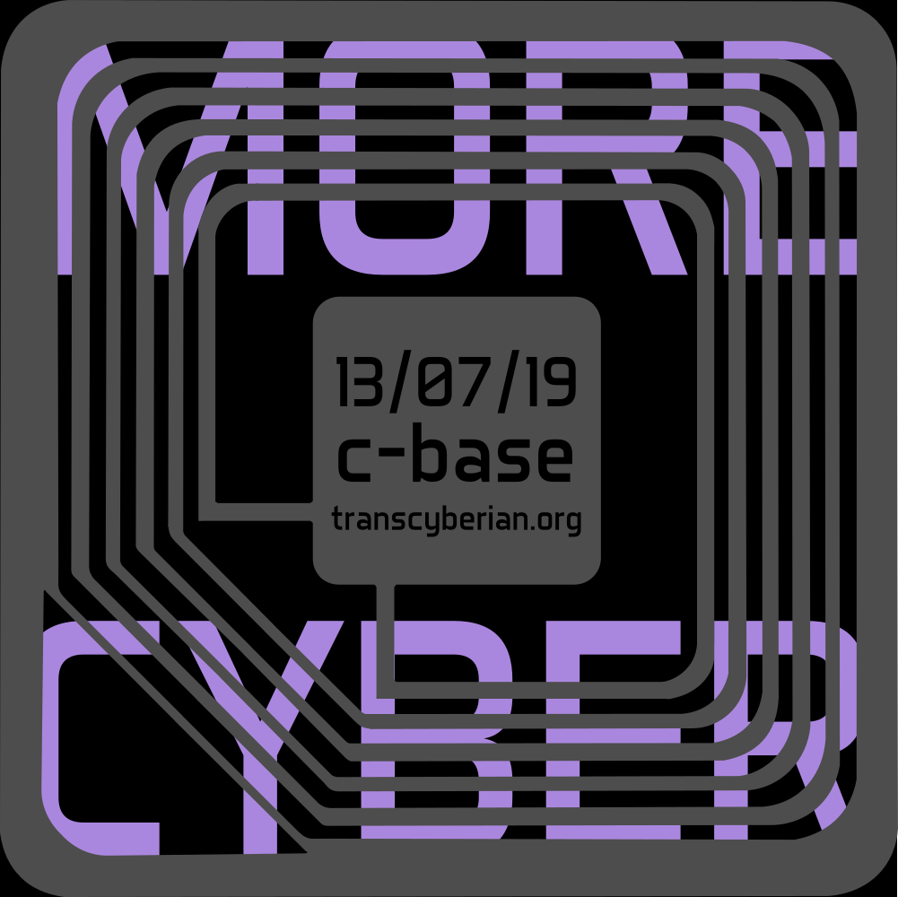
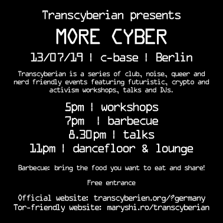
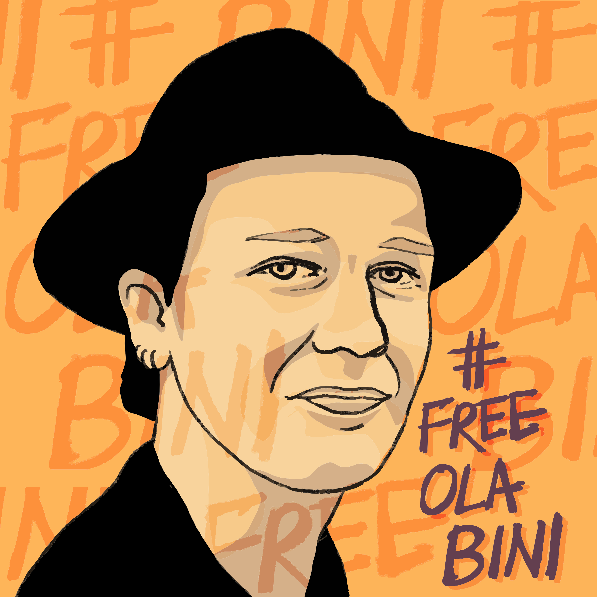

**Save the date! Transcyberian is coming back to Berlin.**

**July 13th, 2019 – c-base**

Transcyberian is a series of club, queer, and nerd friendly events featuring futuristic, crypto, and activism workshops, talks and DJs. Transcyberian is a hybrid concept inspired by CryptoParty. Our events are LGBTQI+-friendly. As we want everyone to be welcome, there is no entrance fee at our events – however if you can afford a donation, it would be much appreciated.

**EDIT: This event is now over. The two first talks where streamed, you can find them on** [**Youtube**](https://youtu.be/SNTGZcfhnrw?t=3492)**.**

**Schedule**

**5pm: Workshops**  
with  
  
**CryptoParty**: At CryptoParties you can learn how to protect yourself in digital spaces. Topics covered include everything from encrypted communication, preventing being tracked while browsing the web, and general security advice regarding computers and smartphones. Bring your laptop!  
  
[**Jos Poortvliet**](https://twitter.com/jospoortvliet) **– Nextcloud for beginners**: There’s no cloud, there’s just other people’s computers! In the era of Google Drive, Dropbox & co., storing your data online has never been easier. However, the simplicity of those tools comes at great cost: your privacy. Learn how to get away from the public cloud and host your own cloud to store and share your files, collaborate, and more! Bring your laptop!  
  
**7pm: Barbecue**  
Bring the food you want to eat and share!  
  
**8.30pm: Talks**  
with  
  
[**Jens Kubieziel**](https://twitter.com/qbi) **– The Zwiebelfreunde raid**: Jens is a member of the board of Zwiebelfreunde e.V., which operates Tor servers and other anonymization technology. In 2018 his house was searched by the German police as a consequence of his position at Zwiebelfreunde. In his talk, he will discuss his experiences, and what we can learn from them.  
  
[**Katharina Nocun**](https://twitter.com/kattascha) **– Was speichert Amazon über seine Nutzer?** Katharina Nocun is a civil rights activist, net activist and economist. In 2018, she published the book “Die Daten, die ich rief” about data collection by states and corporations. She will provide valuable insights into what Amazon does with our data. (Talk in German)  
  
[**Sofía Celi**](https://twitter.com/claucece) **– Support Ola Bini!** Ola Bini, privacy advocahttps://youtu.be/SNTGZcfhnrw?t=3492te and free software developer, was detained as a political prisoner in Ecuador in April. While he was released two months later, the case is still ongoing. Sofia will talk about Ola’s case and its latest updates.  
  
[**Julian Oliver**](https://twitter.com/julian0liver) **– Server infrastructure for Global Rebellion**: In this talk Julian will outline his work as a systems and security architect for the climate and environmental defense movement Extinction Rebellion. Responsible for 20 server deployments in 8 months, including a community hub spanning dozens of national teams (some of which operate in extremely hostile conditions), he will show why community-owned free and open source infrastructure is mission-critical for the growth, success and safety of global civil disobedience movements.  
  
**11pm: Dancefloor & Lounge**  
DJs  
[Barbnerdy](https://twitter.com/Barbnerdy)  
[Tasmo](https://twitter.com/_Tasmo)

Location: [c-base](https://c-base.org/)  
Rungestraße 20 – Berlin

Talks & workshops will be in English, accessible with no background knowledge.

Taking photos or filming is not permitted.  
Please leave the cameras in your pockets.

Looking for our Code of Conduct?  
We have a [Code of Rights and Empowerment](/transcyberian-core/).

Official website: [https://transcyberien.org/?germany/](https://transcyberien.org/?germany/)  
This page has been created as a non-Cloudflared alternative for Tor users.

<iframe loading="lazy" title="c-base spacestation Live Stream" width="960" height="540" src="https://www.youtube.com/embed/SNTGZcfhnrw?start=3492&amp;feature=oembed" frameborder="0" allow="accelerometer; autoplay; encrypted-media; gyroscope; picture-in-picture" allowfullscreen=""></iframe>
