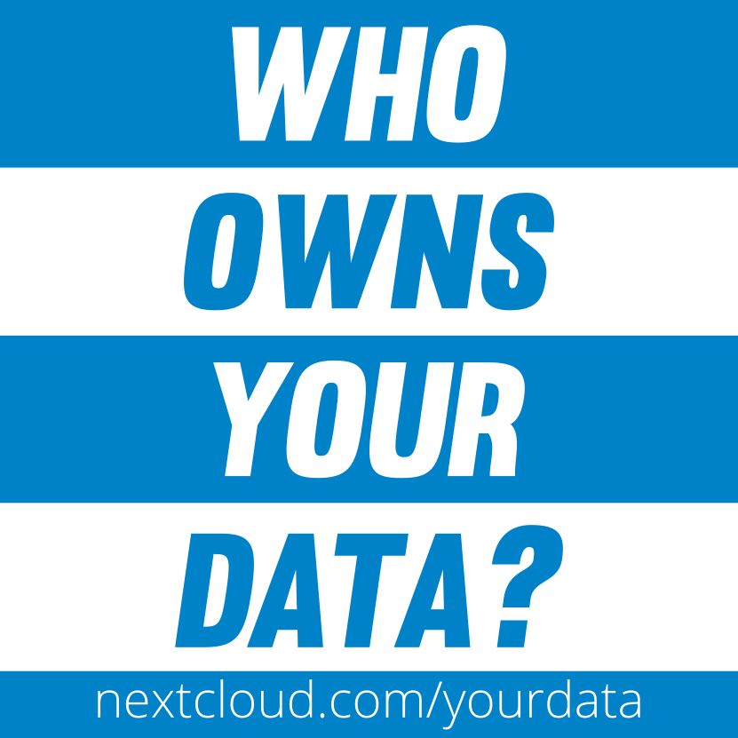

> Where is your data? Where are the pictures from your last vacation on the beach, where is your contact list, where are the last chats you had with your loved ones? Who has access to that data, who can see it, who can download it, who can modify or delete it? Do you trust the services you use to take care of your data?

For the launch of [Nextcloud Simple Signup](https://nextcloud.com/signup/) I designed a little sticker campaign with a page explaining how to use Nextcloud to leave public clouds.  
You can find the page [here](https://nextcloud.com/yourdata/).

